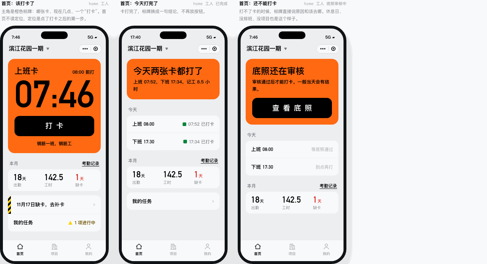

# 界面重做设计：标牌

日期：2026-11-19　状态：设计已确认，待实现

全部页面的设计稿：[`docs/design/ui-redesign/index.html`](../../design/ui-redesign/index.html)（下载后用浏览器打开，77 张屏，覆盖小程序登记的全部 42 个页面）。分组截图在 [`docs/design/ui-redesign/screens/`](../../design/ui-redesign/screens/)，生成脚本在 `docs/design/ui-redesign/src/`。

## 为什么做

现在的界面是白底黑字加细分隔线，几乎没有颜色和层次：数字、状态、入口看上去一样重要。工人在户外强光下、戴着手套用，班组长一天要打开很多次，都需要“一眼看到最重要的那一样，一下就点到该点的地方”。

上一轮改的是操作流程和错误提示，外观没动。这一轮重做外观，并借机把几个挤在一起的页面拆开。

## 目标

1. 每个页面只有一个主角：用的人现在最想知道什么、最该点哪里。
2. 全站一套颜色、字、组件和规矩，工人端和管理端不再是两套外观。
3. 点下去立刻有反应，页面不卡、不跳；动效只用来说明“发生了什么”。
4. 强光下看得清，年纪偏大的工人认得出。

## 不做

- 不新增接口、权限、数据库字段，不改考勤和计工规则。
- 不换图标库，不引入动画库或组件库。
- 不做深色模式。
- 这一轮不拆分包、不改页面路径（见“以后再做”）。

## 不能出现

- 为了好看牺牲速度：首屏变慢、点按有延迟、列表滚动掉帧。
- 页面加载过程中内容上下跳动。
- 同一屏出现两个黑色实心按钮，或两处橙色。
- 状态只靠颜色区分。
- 显示英文常量或没有下一步的报错。

## 约束

- Taro 4.2 + React 18，同一套代码出微信小程序和 H5 演示版；演示版必须继续能跑。
- 小程序主包上限 2MB，当前构建产物约 1.4MB。
- 自定义导航栏（`navigationStyle: custom`），右上角要给微信胶囊让位。
- 样式单位：新写的样式统一用 `rpx`（设计宽度 750），屏幕宽窄变化时整体等比缩放。现有用大写 `Px` 的样式文件在重写该页面时一并改掉，并从 `.prettierignore` 移除。
- 设计稿里的尺寸是按 284 宽的示意手机画的，换算成 `rpx` 乘 2.64 后取整到偶数。

## 考虑过的方案

**第一轮：三种气质。**

| 方案 | 样子 | 取舍 |
| --- | --- | --- |
| A 工地橙 | 安全橙加粗黑描边，像警示牌 | 户外最清楚、辨识度最高；管理端长表单偏重 |
| B 商务蓝 | 蓝色渐变头部、白卡片、彩色图标，像钉钉 | 最稳妥、最常见；没有自己的样子 |
| C 墨金 | 墨黑主卡、琥珀金点缀、细体数字 | 耐看；细体字强光下不清楚 |

选 A。它的问题是每个方块都有粗描边和阴影，一样抢眼，所以进入第二轮。

**第二轮：同一套颜色和字，主角做成什么。**

| 方案 | 主角 | 取舍 |
| --- | --- | --- |
| 标牌 | 最重要的一句话做成一块橙底黑字的标牌 | 最直接、最简洁，四十多个页面都铺得开 |
| 点名板和工牌 | 班组长看名牌，工人看工牌和盖章位 | 最有工地味；班组人多时要另做小格子 |
| 卷尺 | 把一天画成一把卷尺 | 最特别；刻度和圆点堆叠要细调，只适合两三个页面 |

**选定：标牌做底，加上“办完了就盖章”。** 标牌能覆盖所有页面，主次最清楚；红章不和它冲突，又保留了工地的味道。

## 设计系统

### 颜色

颜色都从工地上来，每种只有一个意思。

| 名称 | 色值 | 只用在 |
| --- | --- | --- |
| 反光橙 | `#FF6A13` | 这一页的主角（标牌、工牌顶条）。一屏只出现一处 |
| 黑 | `#000000` | 标牌上的字、正文标题、要点的按钮 |
| 混凝土灰 | `#EDEEF0` | 页面底色 |
| 白 | `#FFFFFF` | 灰底上的内容条 |
| 警示黄 | `#FFD100` | 和黑色组成警戒条，只表示“等你处理”；也是“待处理”三角的颜色 |
| 安全红 | `#D7261E` | 异常：缺卡、迟到、驳回、报错；红章 |
| 安全绿 | `#00843D` | 正常：到岗、已通过 |
| 次要字 | `#7A8087` | 说明、副行 |
| 占位 | `#B4B9BE` | 没填的输入、箭头、不可用 |
| 细线 | `#EEF0F1` | 内容条里的分隔线 |

橙底上写黑字，不写白字。黑字对橙底的对比度约 8:1，白字不到 3:1。

### 字

- 汉字用系统黑体。标题用最粗一档，正文用中粗，说明用常规。
- 数字（时间、人数、工时、分数、邀请码）用 Barlow Condensed Bold，一种公路和工地标牌风格的窄体粗字，SIL OFL 1.1 许可，可以随产品分发。只取数字和 `: . / - % + −` 这些符号做子集，以 base64 写进样式里，不走网络加载，体积控制在 15KB 以内。许可文件一并放进仓库。
- 字号（`rpx`）：标牌大数字 244 到 276；页面结论 64 到 68；标牌标题 50 到 58；卡片标题 42；正文 36；说明和副行 30 到 32；最小不低于 28。

### 形状和间距

- 页面左右边距 36；内容条圆角 36；标牌圆角 48；按钮圆角 36；小标签圆角 20。
- 内容条之间 32；小节标题上 52、下 20。
- 不用阴影，不用渐变。层次靠底色、字重和留白。

### 组件

| 组件 | 用途 | 说明 |
| --- | --- | --- |
| 标牌 `Sign` | 首页和主流程页的主角 | 橙底黑字。内容三选一：大数字加单位、大时间加按钮、一句结论加说明。可带一条黑色例外条和一个黑按钮 |
| 小标牌 `SignLine` | 内页顶上一句结论 | 一行标题加一行说明，可带右侧大数字 |
| 内容条 `Sheet` / `Row` | 所有次要内容 | 白底圆角，行高 126，带副行或头像时 152；行内左主文字、右状态或值、最右箭头 |
| 警戒行 | 等你处理的事 | 内容条的一行，左边 20 宽的黄黑斜条 |
| 状态 `Status` | 一切状态 | 形状加颜色：绿方正常，黄三角待处理，红圆异常；闲置状态只有灰字。只有异常用粗字 |
| 按钮 | 三级 | 主：黑色实心，一屏一个；次：黑框白底；再次：带下划线的字。危险操作用红字或红框，不用红色实心 |
| 底部操作条 | 表单和详情页的主按钮 | 固定在底部，白底，含主按钮和最多两个次要操作，留出安全区 |
| 底部导航 | 三个根页面 | 工人：首页、项目、我的；其它角色：首页、工作台、我的。选中是黑色，其余灰色 |
| 分段 `Segmented` | 标签页和筛选 | 灰底，选中的一格是白色 |
| 日期条 | 按日、周、月翻看 | 左右箭头加中间日期，点日期出选择器 |
| 表单行 | 所有表单 | 左标签右值，必填带红星；多行文本和照片独占一行；出错时该行左侧一条红线，原因写在下方 |
| 步骤条 | 入场七步、打卡四步 | 等分的短横线，走过的是黑色，下面一行“第 N 步，共 M 步：名称” |
| 红章 `Stamp` | 办完了 | 红色双圈圆章，略微倾斜，上面是结果、下面是时间。大号用在结果页，小号用在卡片右上角 |
| 状态页 | 读取中、空、失败 | 读取中用骨架（和真实内容同高的灰块）；空状态一句话加一个去处；失败说明原因并给重试 |

### 规矩

1. 一屏只有一处橙色，一个黑色实心按钮。
2. 标题用名称，按钮用动作，按钮文字就是点了之后发生的事。
3. 等你处理的事集中成一列，带警戒条；处理完就消失。
4. 异常排在前面，正常的只留一个绿方。
5. 办完了落红章：打卡成功、审批通过、底照通过、档案绑定。
6. 读取失败给重试；提交失败在按钮旁说明，不清空已经填的内容。
7. 文案不用间隔号串联一长串信息，不在按钮文字后面加箭头。

## 动效和速度

原则：**反应先于动画。** 动效只做三件事：告诉人“点到了”、“换了内容”、“办完了”。

### 动效清单

| 场合 | 做法 | 时长 |
| --- | --- | --- |
| 点按 | 所有可点的东西按下时变暗或略缩（`hover-class`），松手恢复 | 按下即时，恢复 120ms |
| 分段切换 | 白色选中块滑到新位置 | 160ms |
| 展开收起 | 内容淡入，高度不做动画 | 140ms |
| 打卡四步之间 | 新一步从右侧淡入 24 的位移 | 180ms |
| 红章 | 从 1.5 倍缩到原大并转到最终角度，同时淡入；全程只这一处有“落下”的感觉 | 240ms |
| 骨架 | 灰块缓慢明暗变化 | 1.2s 循环，读取结束即停 |
| 提交中 | 主按钮变灰并显示“…中”，不换成转圈遮罩 | 无 |

- 只动 `transform` 和 `opacity`，不动宽高、边距和颜色以外会引起重排的属性。
- 不用 JS 逐帧驱动，不为动画调用 `setData`。
- 除骨架外没有循环动画。没有入场的整页滑动、没有列表逐条飞入。
- 缓动统一用 `cubic-bezier(.2,.8,.2,1)`。

### 速度

- **先显示上次的数据，再悄悄刷新。** 首页、我的项目、今日安排、班组概览这几类读取做一层内存缓存：进页面先用缓存渲染，同时请求新数据，回来后替换。缓存只在本次运行期间有效，退出登录清空。
- **回到页面不无条件重读。** 距上次成功读取不到 30 秒时，`useDidShow` 不触发刷新；拍照、人脸等会让页面隐藏再显示的操作不再引发整页重载。下拉刷新和提交成功后仍然强制重读。
- **按钮防连点。** 请求发出后主按钮立刻禁用，直到有结果。
- **字体内嵌**，不走网络；图标沿用现有的本地 PNG。
- **图片**：列表里的照片用缩略尺寸并懒加载。

### 稳定

- 读取中的骨架和真实内容等高，数据回来时页面不跳。
- 长名字、长地址一律单行省略，不把右侧状态挤出去。
- 以 320 宽的小屏和 430 宽的大屏各检查一遍；底部操作条和底部导航留出安全区。
- 所有读取都有失败状态和重试；所有提交都有失败说明。
- 演示版和正式版走同一套页面，每个阶段都要两种构建通过。

### 验收数字

- 点按到出现按下状态：不超过 100ms。
- 有缓存时进入首页到出现内容：不超过 300ms。
- 小程序构建产物不超过 1.6MB，其中字体不超过 15KB。
- 类型检查、现有单元测试、微信小程序构建、H5 演示构建全部通过。

## 页面和结构变化

每个页面属于下面五种版式之一。主角和具体内容以设计稿为准。

| 版式 | 结构 | 页面 |
| --- | --- | --- |
| 首页 | 标牌，等你处理，入口或本月数字，底部导航 | `home`（工人、班组长、项目管理员、公司管理员、超级管理员五种） |
| 流程 | 步骤条，一句话，一块内容，底部主按钮 | `complete-profile` `bind` `worker-registration` `face-profile` `punch` `punch-test` |
| 列表 | 筛选，小标牌，内容条，底部主按钮 | `my-projects` `my-tasks` `my-records` `my-makeups` `team-work` `team-safety` `safety-credit` `team-makeups` `team-attendance` `reports` `company-reports` `participants` `company-people` `company-projects` `project-management` `safety-review` `face-review` `invitation` `system-management` |
| 表单 | 分组的表单行，底部主按钮 | `submit-makeup` `person-form` `person-reuse` `team-detail` `project-detail` `project-worktime` `create-project` `schedules` `safety-policy` |
| 详情 | 小标牌或工牌，内容条 | `my-project-detail` `my-safety-credit` `profile` `permission-levels` `workspace` `team-log` `login` |

和现在相比，结构上的变化有这些：

| 页面 | 现在 | 改成 |
| --- | --- | --- |
| `punch` | 一页里放四步，页头里挤着切换时点、加班打卡、加班补卡 | 一屏一步：定位、现场照片、安全交底、人脸核验，然后是结果页。时点切换和加班入口收进单独的“今天的卡”视图。仍是同一个页面路径，内部按步骤切换 |
| `team-work` | 一张任务卡片展开后有八块内容 | 拆成列表、新建、选人、安排详情、邀请临时工五个视图。仍是同一个页面路径 |
| `home` 班组长 | 我的打卡卡片、班组概览、工人名单、班组入口、个人入口依次排下来 | 标牌说几人到岗和谁没到；自己的卡和待审批并入“等你处理”；工人名单移到班组考勤；个人入口移到“我的” |
| `workspace` | 管理入口和个人入口混在一起 | 只放管理入口；个人的考勤、补卡、任务归到“我的” |
| `profile` | 工人和管理人员两套布局 | 一套：工牌，个人资料类，记录类。管理人员多出“我的项目、我的任务、我的考勤、补卡申请” |
| `project-detail` | 上半截是八个项目入口，下半截是项目设置，挤在一页 | 分成两个视图：“进入项目”（八个入口加一行项目设置，公司管理员从公司项目进来看到的）和“项目设置”（项目管理员从工作台直接到这里）。仍是同一个页面路径 |
| `person-form` | 三个身份各占一行勾选 | 一行里点选，可多选；选了班组长才出现“管哪个班组” |
| `team-attendance` `reports` `company-reports` | 十四个统计格全部摊开 | 小标牌说结论，下面只留三个最常看的，其余进“全部统计” |
| `team-safety` | 交底、隐患的表单在列表页里展开 | 发布交底是单独的表单视图；待整改单独一个标签 |
| `my-records` | 工人和管理人员两套布局 | 一套，异常那天下面就是补卡入口 |

## 实现时的几个决定

设计稿交给一位没参与讨论的实现者预读后，有四处需要说清。这些是设计者的决定，不是用户逐条确认过的。

1. **“当前身份和范围”不做全局状态，和现在一样。**
   - 首页仍按最高职级显示。页头的名称可以切换：工人切项目，班组长切班组，选择记在本机，下次打开还在。
   - 工作台的职级和范围选择仍是工作台自己的；在工作台切换不改变首页。
   - 管理页面的范围仍由进入时的链接参数带入。
   - 公司管理员“进入项目”是推入一个带返回的页面，不是把整个小程序切到那个项目；按返回就回到公司。
2. **首页不读定位。** 设计稿早期版本的首页标牌上有“已在考勤范围内”，那是示意，已改成班组和工种。定位只在点了“打卡”之后的第一步进行，首页不弹定位授权。
3. **打卡第一步的图是示意图，不是地图组件。** 用普通视图画一个圆和一个点，表示考勤范围和你的位置，两种构建里样子一致，也不在最常用的流程里放原生组件。真正的地图只留在“项目详情”和“项目设置”里。
4. **一个列表里有多条都要处理时，一次只展开一条。** 补卡审批、违规复核、底照审核都是这样：其余的收成一行，点哪条展开哪条，屏上始终只有一个黑色实心按钮。“我的任务”和“我的项目”不折叠，只有正在做或最先要做的那一个用黑按钮，其余用黑框。

关于验收数字怎么量：

- 100ms 和 300ms 是在微信开发者工具的模拟器和一台中等配置的安卓手机上量，用小程序自带的性能面板和手动打点。真机部分需要有人拿手机测，开发阶段只能先保证模拟器达标。
- 底部导航这一轮仍用现有的 `reLaunch` 切换。缓存是模块级的，页面重建后能立刻用上次的数据渲染。

## 以后再做

- 把三个根页面做成常驻的标签页（`switchTab`），切换不再重建页面。要改所有跳到这三个页面的地方，演示版也要跟着处理，所以等外观重做完成、在低端安卓上量过再单独做。
- 把管理端页面放进分包，减小主包、加快首次打开。需要改页面路径和所有跳转，单独做，先量数据再决定。
- 班组超过二十人时的点名格子视图。
- 工人查看本人项目评分的入口。

## 留给实现者决定

- 组件内部怎么拆、文件怎么放，以现有 `components/ui` 的写法为准。
- 缓存层的具体接口，只要满足“先显示上次的数据，再刷新”和“30 秒内不重读”。
- 每个页面骨架的具体灰块排布，只要和真实内容等高。
- 设计稿里没有画出的次要状态（例如各种读取失败），按“状态页”组件的规矩处理。
- 设计稿里的示意数据不是真实数据，字段和文案以代码和接口为准。

## 分期

每一期结束都要：类型检查、单元测试、两种构建通过；在演示版里截图和设计稿对照；在微信开发者工具里走一遍。

1. **地基**：颜色和字的变量、数字字体、动效样式、全部公共组件、底部导航和页头。做完后所有页面的底色、按钮、状态、列表行已经换成新样子。
2. **工人和入场**：工人首页、打卡四步、我的项目、任务、考勤、补卡、信用、我的；登录、资料、绑定、用工登记、人脸底照。同时做缓存和“30 秒内不重读”。
3. **班组长**：首页、工作台、工作安排五个视图、班组安全、安全信用、日报、打卡安排、补卡审批、班组考勤。
4. **项目、公司和平台**：其余管理页面。
